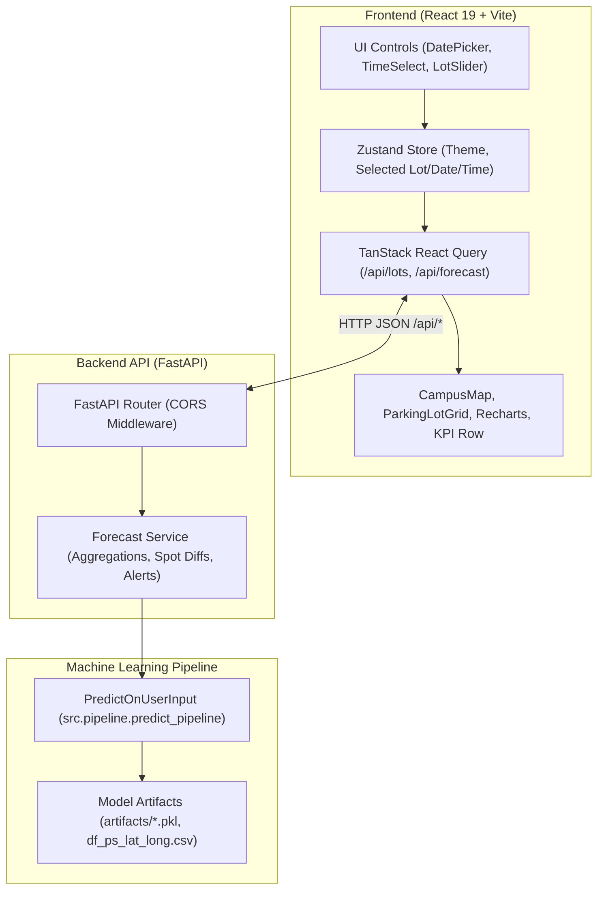

# ParkPilot 🅿️

> **Intelligent parking space availability prediction and smart parking recommendation system.**

ParkPilot is an end-to-end full-stack machine learning application designed to reduce urban congestion and driver search time by accurately forecasting parking space availability across parking lots in Birmingham, UK. Built with a high-performance **FastAPI** backend and a responsive **React 19 + Vite** frontend, ParkPilot pairs machine learning time-series regression with interactive maps, radar analytics, and real-time parking spot visualizations.

---

## Table of Contents

1. [Overview & Problem Statement](#overview--problem-statement)
2. [Key Features](#key-features)
3. [Technology Stack](#technology-stack)
4. [System Architecture](#system-architecture)
5. [Machine Learning Approach](#machine-learning-approach)
6. [Dataset Sources & Attribution](#dataset-sources--attribution)
7. [Project Directory Structure](#project-directory-structure)
8. [Prerequisites](#prerequisites)
9. [Installation & Setup (Windows)](#installation--setup-windows)
10. [Environment Variables & Configuration](#environment-variables--configuration)
11. [Running the Application](#running-the-application)
12. [API Endpoints & Verification](#api-endpoints--verification)
13. [How to Use the Application](#how-to-use-the-application)
14. [Testing & Verification](#testing--verification)
15. [Known Limitations](#known-limitations)
16. [Future Improvements](#future-improvements)
17. [License](#license)

---

## Overview & Problem Statement

Searching for available parking in dense metropolitan areas increases traffic congestion, driver stress, and vehicle emissions from excessive idling. 

**ParkPilot** addresses this challenge by providing predictive intelligence for city parking facilities:
- Drivers can select a target arrival date and time to see anticipated lot occupancy before departing.
- Dynamic color-coded campus map markers visually guide users to lots with the highest availability.
- An automated recommendation system suggests optimal alternative lots if the chosen facility is congested.
- A visual 45-spot parking bay animation provides an intuitive representation of facility capacity and congestion trends.

---

## Key Features

- **Interactive Campus Map**: Powered by `React-Leaflet`, rendering all 27 Birmingham parking facilities with dynamic color markers (`Green` ≥ 60% available, `Yellow` 30–59% available, `Red` < 30% available).
- **Multi-Facility XGBoost Forecasting**: Evaluates and forecasts occupancy rates across all 27 parking facilities simultaneously for any target 30-minute time step.
- **Dynamic Parking Bay Grid**: A 45-bay interactive layout with Framer Motion animations that diff-checks vehicle arrivals and departures based on forecasted occupancy changes.
- **Forecast Radar & Trend Analysis**: 
  - 5-point time checkpoint radar chart displaying demand progression across the day.
  - Interactive historical vs. forecasted time-series curve using `Recharts`.
- **Smart Parking Advisory**: Automatic generation of actionable guidance (`good`, `warn`, or `bad`), highlighting when parking is tight and recommending the best alternative lot by capacity and availability.
- **Real-Time KPI Suite**: Instant readouts for selected lot availability %, campus-wide average availability, best alternative facility, and worst-case congested lot.
- **Modern UI / Dark & Light Modes**: Glassmorphism design system built with Tailwind CSS v4, smooth theme toggling, and accessible controls.

---

## Technology Stack

### Frontend
- **Framework**: [React 19](https://react.dev/) with [TypeScript](https://www.typescriptlang.org/)
- **Bundler / Dev Server**: [Vite 8](https://vitejs.dev/)
- **Styling**: [Tailwind CSS v4](https://tailwindcss.com/) with custom design tokens
- **Animations**: [Framer Motion](https://www.framer.com/motion/)
- **Mapping**: [Leaflet](https://leafletjs.com/) & [React-Leaflet](https://react-leaflet.js.org/)
- **Data Visualization**: [Recharts 3](https://recharts.org/)
- **State Management**: [Zustand](https://github.com/pmndrs/zustand)
- **Data Fetching / Cache**: [TanStack React Query v5](https://tanstack.com/query)

### Backend
- **Web Framework**: [FastAPI](https://fastapi.tiangolo.com/)
- **ASGI Server**: [Uvicorn](https://www.uvicorn.org/)
- **Data Validation & Schemas**: [Pydantic v2](https://docs.pydantic.dev/)
- **Machine Learning & Data Processing**:
  - [XGBoost](https://xgboost.readthedocs.io/) (Gradient-boosted decision trees for regression)
  - [Scikit-learn](https://scikit-learn.org/) (Preprocessing and `StandardScaler` transformations)
  - [Pandas](https://pandas.pydata.org/) & [NumPy](https://numpy.org/) (Time-series data manipulation)

---

## System Architecture



1. **User Input**: The user selects a target date (`2016-12-13` to `2016-12-19`), arrival time (30-minute intervals from `08:00` to `16:30`), and desired parking lot.
2. **API Request**: The React client dispatches a `POST /api/forecast` request via TanStack Query to the FastAPI server.
3. **Pipeline Inference**: FastAPI invokes `run_forecast()` in `backend/app/services/forecast_service.py`, which instantiates `PredictOnUserInput` from the ML pipeline.
4. **Model Execution**: The pipeline standardizes lag features and runs the pre-trained facility-specific XGBoost models to forecast occupancy rates across all 27 parking lots.
5. **Payload Response**: FastAPI returns calculated availability percentages, 5-point radar checkpoints, deterministic occupied spot indices, and recommendation alerts.
6. **Reactive Render**: React updates the interactive map markers, plots the forecast curve, and animates vehicle movements in the 45-spot lot grid.

---

## Machine Learning Approach

- **Task**: Multi-facility multivariate time-series regression predicting parking occupancy rates ($0\% - 100\%$).
- **Algorithm**: **XGBoost Regressor (`XGBRegressor`)**, trained independently per parking facility to capture unique daily and weekly seasonality patterns.
- **Feature Engineering**:
  - **Calendar & Cyclical Features**: `Month`, `Day of Month`, `Day of Week`, `isWeekend`, `Hour`, `Minute`.
  - **Lag Features**: Historical occupancy rates across prior 30-minute time intervals.
  - **Preprocessing**: Feature scaling using fitted `StandardScaler` instances saved per lot.
- **Inference Strategy**: Iterative multi-step forecasting up to the chosen future timestamp index.
- **Conversion to Availability**:
  $$\text{Availability } (\%) = 100\% - \text{Occupancy Rate } (\%)$$

---

## Dataset Sources & Attribution

1. **Birmingham Parking Dataset**:
   - **Source**: [UCI Machine Learning Repository: Parking Birmingham Data Set](https://archive.ics.uci.edu/dataset/482/parking+birmingham)
   - **Description**: Occupancy rates across Birmingham parking lots collected from October 2016 to December 2016 in 30-minute intervals between 08:00 and 16:30.
2. **UK Car Parks Geospatial Metadata**:
   - **Source**: [Department for Transport UK Car Parks Metadata](https://hub.arcgis.com/datasets/bureau::department-for-transport-uk-car-parks/explore)
   - **Description**: Geospatial coordinates (latitude and longitude) and parking capacities matched to the Birmingham facilities.

---

## Project Directory Structure

```text
ParkPilot/
├── artifacts/                      # Global ML models, scalers, and coordinate CSVs
│   ├── df_ps_lat_long.csv          # Lot metadata (ID, coordinates, capacity)
│   ├── df_ts_final.csv             # Processed time-series dataset
│   ├── fit_models_best_dict.pkl    # Serialized XGBoost regression models
│   ├── fit_std_scaler_dict.pkl     # Serialized StandardScalers
│   ├── reg_v1_train_test_dict.pkl  # Train/test split dictionaries with forecast index
│   └── reg_v2_train_test_dict.pkl  # Extended feature split dictionaries
├── backend/                        # FastAPI REST API service
│   ├── app/
│   │   ├── main.py                 # FastAPI application, CORS, routes (/api/lots, /api/forecast)
│   │   ├── schemas.py              # Pydantic models for requests and responses
│   │   ├── services/
│   │   │   └── forecast_service.py # Forecast runner, spot calculations, alerts
│   │   └── src/                    # Pipeline and utility package for backend execution
│   │       ├── exception.py        # Custom exception handler
│   │       ├── utils.py            # Pickle load/save helper
│   │       └── pipeline/
│   │           └── predict_pipeline.py # Model loading & inference pipeline
│   ├── artifacts/                  # Local copy of artifacts for backend portability
│   └── requirements.txt            # Python dependencies for the backend
├── docs/                           # Architectural specs & rebuild design notes
│   ├── design.md                   # UI/UX design tokens and motion guidelines
│   └── react-rebuild-spec.md       # Technical specification for FastAPI + React rebuild
├── frontend/                       # React 19 + TypeScript + Vite web application
│   ├── public/                     # Favicons and SVG sprite assets
│   ├── src/
│   │   ├── api/
│   │   │   ├── client.ts           # Fetch client with VITE_API_URL fallback
│   │   │   └── queries.ts          # TanStack Query hooks (useLots, useRunScan)
│   │   ├── components/
│   │   │   ├── alerts/             # AlertBanner component
│   │   │   ├── chart/              # LotChart (Recharts historical & forecast curves)
│   │   │   ├── controls/           # DatePicker, TimeSelect, LotSlider, ThemeToggle
│   │   │   ├── forecast/           # ForecastCard and ForecastRadar
│   │   │   ├── kpi/                # KpiCard and KpiRow summary statistics
│   │   │   ├── layout/             # Sidebar navigation and header
│   │   │   ├── lot/                # ParkingLotGrid, Spot, and animated Car components
│   │   │   ├── map/                # CampusMap (React-Leaflet interactive map)
│   │   │   └── shared/             # Skeleton loaders
│   │   ├── hooks/                  # Custom hooks (useCountUp)
│   │   ├── store/                  # useAppStore (Zustand state store)
│   │   ├── styles/                 # index.css (Tailwind v4 theme variables)
│   │   ├── types/                  # TypeScript interfaces (ForecastResponse, LotMeta, etc.)
│   │   ├── App.tsx                 # Main dashboard layout
│   │   └── main.tsx                # Client application root
│   ├── package.json                # Frontend scripts and npm dependencies
│   ├── tailwind.config.ts          # Tailwind CSS configuration
│   ├── tsconfig.json               # TypeScript configuration
│   └── vite.config.ts              # Vite server & build plugins
├── notebooks/                      # Exploratory data analysis and model training
│   ├── data/                       # Raw parking occupancy and metadata CSVs
│   ├── nb1_parking_availability_starter.ipynb
│   ├── nb2_hyperparameter_tuning.ipynb
│   ├── nb3_model_training_sarima_all_parkspaces.ipynb
│   └── nb4_predictionFlow.ipynb
├── src/                            # Shared prediction pipeline code
│   ├── exception.py
│   ├── utils.py
│   └── pipeline/
│       └── predict_pipeline.py
├── requirements.txt                # Root Python dependencies
└── README.md                       # Comprehensive project documentation
```

---

## Prerequisites

Before running the application, ensure you have the following installed on your system:

- **Operating System**: Windows 10/11 (or macOS / Linux)
- **Python**: Version `3.10` to `3.12` recommended
- **Node.js**: Version `18.x` or higher (includes `npm`)
- **Git**: Installed and configured

---

## Installation & Setup (Windows)

### 1. Clone the Repository
```powershell
git clone https://github.com/KovvaliVijay/ParkPilot.git
cd ParkPilot
```

### 2. Set Up the Python Virtual Environment
```powershell
# Create a virtual environment named 'venv'
python -m venv venv

# Activate the virtual environment
venv\Scripts\activate

# Upgrade pip and install backend dependencies
python -m pip install --upgrade pip
pip install -r requirements.txt
```

### 3. Install Frontend Dependencies
```powershell
cd frontend
npm install
cd ..
```

---

## Environment Variables & Configuration

### Frontend Configuration
The frontend connects to the backend API via `frontend/src/api/client.ts`. By default, it connects to:
```text
http://localhost:8000
```

To configure a custom backend URL (for instance, in a production or remote environment), create a `.env` file in the `frontend/` directory:
```bash
# frontend/.env
VITE_API_URL=http://127.0.0.1:8000
```

### Backend CORS Configuration
The backend CORS settings are configured in `backend/app/main.py`. The server permits requests from:
- `http://localhost:5173` (Vite default dev server)
- `http://127.0.0.1:5173`

---

## Running the Application

To run the application, start both the backend API and the frontend client in two separate terminal windows.

### Terminal 1: Start the Backend (FastAPI)
```powershell
cd "j:\learning programing language\ParkPilot\backend"
..\venv\Scripts\activate
uvicorn app.main:app --host 127.0.0.1 --port 8000 --reload
```
- **API URL**: [http://127.0.0.1:8000](http://127.0.0.1:8000)
- **Interactive Swagger Docs**: [http://127.0.0.1:8000/docs](http://127.0.0.1:8000/docs)
- **Health Check**: [http://127.0.0.1:8000/api/health](http://127.0.0.1:8000/api/health)

### Terminal 2: Start the Frontend (React + Vite)
```powershell
cd "j:\learning programing language\ParkPilot\frontend"
npm run dev
```
- **Web Application URL**: [http://localhost:5173/](http://localhost:5173/)

---

## API Endpoints & Verification

The FastAPI backend exposes the following REST API endpoints:

### 1. Health Check
- **Route**: `GET /api/health`
- **Description**: Verifies that the server process is responsive.
- **Example Response**:
  ```json
  {
    "status": "ok"
  }
  ```

### 2. Retrieve All Parking Lots
- **Route**: `GET /api/lots`
- **Description**: Returns metadata for all 27 parking facilities, including coordinates and total parking capacity.
- **Example Response**:
  ```json
  [
    {
      "ps_idx": 1,
      "latitude": 52.475741,
      "longitude": -1.891063,
      "capacity": 577
    },
    {
      "ps_idx": 2,
      "latitude": 52.480422,
      "longitude": -1.830195,
      "capacity": 317
    }
  ]
  ```

### 3. Generate Parking Forecast
- **Route**: `POST /api/forecast`
- **Description**: Executes the ML pipeline to predict parking availability across all lots for the requested date, time, and focus facility.
- **Example Request Payload**:
  ```json
  {
    "date": "2016-12-19",
    "time": "10:00",
    "selected_lot": 1
  }
  ```
- **Example Response Payload**:
  ```json
  {
    "selected_lot": 1,
    "selected_availability": 87.1,
    "availability_level": "Easy",
    "avg_availability": 65.4,
    "best_lot": {
      "ps_idx": 13,
      "latitude": 52.4821,
      "longitude": -1.8992,
      "capacity": 800,
      "availability": 94.2
    },
    "worst_lot": {
      "ps_idx": 4,
      "latitude": 52.4784,
      "longitude": -1.9043,
      "capacity": 387,
      "availability": 18.5
    },
    "all_lots": [
      {
        "ps_idx": 1,
        "latitude": 52.475741,
        "longitude": -1.891063,
        "capacity": 577,
        "availability": 87.1
      }
    ],
    "checkpoints": [
      { "label": "08:00", "occupancy_pct": 11.2, "is_tight": false },
      { "label": "10:00", "occupancy_pct": 12.9, "is_tight": false },
      { "label": "12:00", "occupancy_pct": 18.4, "is_tight": false },
      { "label": "14:30", "occupancy_pct": 22.1, "is_tight": false },
      { "label": "16:30", "occupancy_pct": 15.0, "is_tight": false }
    ],
    "historical_series": [
      { "timestamp": "2016-12-06 08:00:00", "value": 85.2 }
    ],
    "forecast_series": [
      { "timestamp": "2016-12-19 10:00:00", "value": 87.1 }
    ],
    "occupied_spots": [3, 7, 12, 19, 28, 33],
    "alert_level": "good",
    "alert_message": "Good parking window. Lot 1 is predicted to have 87.1% availability."
  }
  ```

---

## How to Use the Application

1. Open **[http://localhost:5173/](http://localhost:5173/)** in your browser.
2. In the **Sidebar**:
   - **Date Picker**: Choose a date within the trained model evaluation window (`2016-12-13` to `2016-12-19`).
   - **Time Select**: Choose a target time from `08:00` to `16:30` (30-minute intervals).
   - **Lot Slider**: Select a parking facility (Lot 1 through 27).
   - Click **Run Live Prediction** (or press `Enter`).
3. View the **Interactive Campus Map**:
   - The map centers on the selected facility.
   - All 27 lots display real-time status colors: **Green** (Easy), **Yellow** (Moderate), or **Red** (Tight).
   - Hover or click on any lot marker to view its capacity and predicted availability.
4. Review the **Advisory & KPIs**:
   - An alert banner displays automated advice and highlights alternative parking options if availability is low.
   - KPI cards report availability, total campus average, and best/worst facilities.
5. Explore the **Simulated Lot Grid & Radar**:
   - The 45-spot parking bay animates vehicle arrivals and departures between forecast updates.
   - The radar chart highlights intra-day demand across key time checkpoints.

---

## Testing & Verification

The following verification steps have been executed and confirmed:

### 1. Frontend Build & TypeScript Validation
```powershell
cd frontend
npm run build
```
- **Result**: `tsc -b && vite build` completed with code `0`. All TypeScript modules, components, and Tailwind v4 CSS bundles compile with zero errors.

### 2. Frontend Code Quality & Linting
```powershell
cd frontend
npm run lint
```
- **Result**: `oxlint` executed cleanly across all components and hooks.

### 3. Backend API Test Suite
Run the following script to verify active backend endpoints:
```powershell
.\venv\Scripts\python.exe -c "
import urllib.request, json
# Health check
r = urllib.request.urlopen('http://127.0.0.1:8000/api/health')
print('Health check:', r.getcode(), json.loads(r.read()))
# Lots check
r = urllib.request.urlopen('http://127.0.0.1:8000/api/lots')
lots = json.loads(r.read())
print('Lots check:', r.getcode(), 'Lots count:', len(lots))
# Forecast check
req = urllib.request.Request(
    'http://127.0.0.1:8000/api/forecast',
    data=json.dumps({'date':'2016-12-19','time':'10:00','selected_lot':1}).encode('utf-8'),
    headers={'Content-Type':'application/json'}
)
r = urllib.request.urlopen(req)
fc = json.loads(r.read())
print('Forecast check:', r.getcode(), 'Selected availability:', fc['selected_availability'], '%')
"
```
- **Result**: All endpoints returned HTTP `200` with valid JSON payloads.

---

## Known Limitations

- **Model Forecast Horizon**: The pre-trained models and test dataset index in `reg_v1_train_test_dict.pkl` support evaluations within the range **2016-12-13** through **2016-12-19** between **08:00 AM** and **04:30 PM**. The UI controls enforce this range to prevent index errors.
- **Representative Spot Grid**: The 45-spot parking bay visualizer uses a deterministic random generator weighted by the predicted availability percentage to simulate parking bay occupancy for the selected lot.
- **Historical Data**: The current dataset does not include real-time live IoT telemetry or current-year calendar data.

---

## Future Improvements

- **Live IoT Ingestion**: Connect live camera/sensor MQTT streams for real-time occupancy updates.
- **Automated Re-training Pipeline**: Schedule regular model re-training using GitHub Actions or Airflow.
- **Navigation & Routing**: Direct turn-by-turn routing via OpenStreetMap or Google Maps to the recommended parking facility.
- **User Accounts & Preferences**: Allow drivers to bookmark favorite parking spots and receive congestion push notifications.

---

## License

This project is currently distributed as an open repository. Please review the repository settings or contact the author before using or distributing this code in commercial applications.
